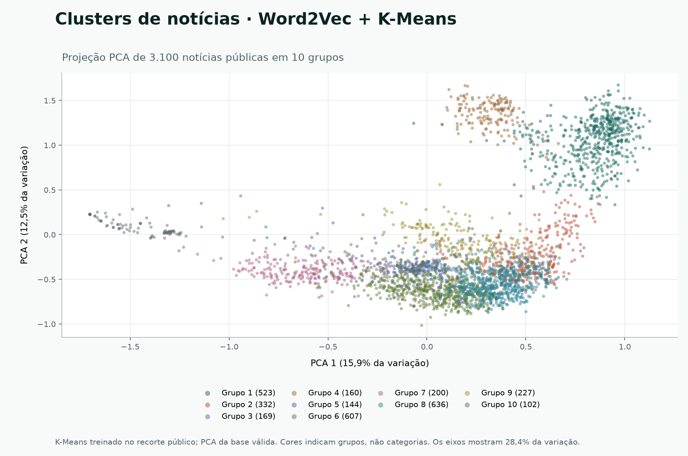

# Noticias de Blumenau - projeto de PLN

Autores: Stephanie Possamai, Cristian Monster, Beatriz Mariah, Beatriz Conrat
e Julia Welter.

## Resumo para apresentacao

| Aspecto | Resultado nesta versao |
|---|---|
| Problema | Organizar e recuperar noticias locais publicadas em categorias editoriais amplas. |
| Dados | Blog do Jaime: 4.081 registros coletados, 3.459 noticias validas apos limpeza e 3.100 noticias no indice publico. |
| Demonstracao | Busca TF-IDF, Word2Vec, hibrida e comparacao lado a lado; aba de resultados; agente local que gera boletins e envia por e-mail. |
| Tecnicas | TF-IDF, Word2Vec, fusao RRF, K-Means, PCA e geracao fundamentada em noticias recuperadas com Gemini. |
| Evidencias | No experimento original com 12 grupos e a base valida completa, Word2Vec teve silhouette 0,326 e pureza 0,722; TF-IDF teve 0,107 e 0,714. A alternativa Word2Vec com 10 grupos no recorte publico teve 0,293 e 0,692. Essas medidas nao avaliam diretamente a busca. |
| Limites | Uma fonte, recorte temporal, categorias amplas e ausencia de julgamentos humanos de relevancia. O agente depende de servidor local e de acervo atualizado. |

Para apresentar: busque `acidente no centro` e alterne entre os quatro metodos;
na aba **Resultados**, compare os agrupamentos. Com o servidor local ativo,
gere uma previa semanal sobre `mobilidade` na aba **Agente**. O link publico da
aplicacao ainda precisa ser configurado; a busca e os graficos podem ser
publicados como site estatico, enquanto o agente requer servidor Python.

### Visualizacao 2D dos clusters



Cada ponto representa uma noticia do indice publico; a cor representa o grupo
atribuido pelo K-Means, nao a categoria editorial. Os 10 grupos foram treinados
apenas nas 3.100 noticias publicas, e o menor contem 102 noticias. As
coordenadas PCA foram calculadas na base valida completa; os dois eixos
explicam 28,4% da variacao desses vetores. O agrupamento publico com 10 grupos
teve silhouette **0,293064** e pureza **0,691613**. No mesmo recorte com 12
grupos, os valores foram **0,299038** e **0,694516**; portanto a reducao para
10 grupos equilibrou os tamanhos, mas nao melhorou essas metricas. O
experimento original de 12 grupos na base completa permanece para comparacao.
A imagem vem de `web/data/results.json`, e a aba **Resultados** permite
alternar entre as duas versoes do Word2Vec e o agrupamento TF-IDF original.

## Aplicacao web (versao de demonstracao)

A pagina em `web/` apresenta uma busca funcional sobre as noticias do projeto.
Ela compara TF-IDF, Word2Vec e uma fusao dos rankings (Reciprocal Rank Fusion,
RRF), com exemplos de consultas, filtro por categoria e links para a fonte.
As abas separam busca, noticias recentes, resultados do modelo atualizado,
informacoes sobre atualizacoes/alertas e metodologia. Na busca, a explicacao
ao lado do seletor muda entre Hibrida, TF-IDF, Word2Vec e Comparar. A busca
roda no navegador, sem conta ou chave externa. O link publico ainda nao foi
configurado.

Para visualizar localmente, na raiz do repositorio (com as dependencias
instaladas):

```powershell
python web_server.py
```

Abra `http://127.0.0.1:8765/`. A aba "Atualizacoes e alertas" e informativa:
a interface publica nao oferece botoes para executar coleta, agendamento ou
notificacoes. O servidor local conserva as rotinas de atualizacao. Para
hospedar a busca, o acervo e os resultados sem servidor Python, basta servir
a pasta `web/` como site estatico. A aba Agente so funciona com o servidor
local; em hospedagem estatica ela informa que esta indisponivel.

### Agente local de noticias

A aba **Agente** permite informar um assunto, escolher relatorio diario ou
semanal, definir horario e e-mail, gerar uma previa e ativar o envio local.
O servidor usa os mesmos indices da aba Buscar (TF-IDF, Word2Vec e RRF) e
seleciona ate oito noticias do ultimo dia ou dos ultimos sete dias do acervo.
O ranking prioriza pertinencia e desempata por data. Usa um limiar exploratorio
para evitar resultados vagamente relacionados. Para buscas por Oktoberfest ou
Sommerfest, exige mencao do evento no titulo ou na categoria, evitando
mencoes laterais no corpo da noticia. O termo "Blumenau" e ignorado no agente
quando ha outro termo pesquisavel, pois quase todo o acervo se refere a cidade.
Envia ao Gemini titulo, data, URL e ate 1.800 caracteres do texto de cada
noticia selecionada. O prompt pede resumo, ate quatro destaques e observacao
em JSON estruturado, com numeros das fontes de cada destaque. O servidor
valida as referencias e monta o e-mail em HTML (titulo, periodo, destaques e
fontes clicaveis), com alternativa em texto simples. Noticias sem relacao
direta devem ser descartadas; se nao houver destaques, nao ha envio. A chamada
usa `store=false` e limita a saida a 1.200 tokens. A selecao e a redacao ainda
precisam de verificacao humana.

Copie `.env.example` para `.env` na instalacao local e preencha
`GEMINI_API_KEY` com a chave do Google AI Studio. O modelo inicial
e `gemini-3.1-flash-lite`, ajustavel em `GEMINI_MODEL`. Para enviar, informe
`SMTP_HOST`, `SMTP_PORT`, `SMTP_FROM` e, se o servidor exigir autenticacao,
`SMTP_USER` e `SMTP_PASSWORD`. Porta 587 usa STARTTLS; porta 465 usa SSL.
`SMTP_REQUIRE_AUTH=1` exige usuario e senha; para um relay SMTP local
autorizado sem autenticacao, use `SMTP_REQUIRE_AUTH=0`.
O envio implementado usa autenticacao SMTP por usuario e senha ou um relay
local autorizado; nao implementa OAuth2 para contas Outlook.com.
Para Gmail, use `SMTP_HOST=smtp.gmail.com`, `SMTP_PORT=587`,
`SMTP_REQUIRE_AUTH=1` e o mesmo endereco Gmail em `SMTP_USER` e `SMTP_FROM`.
Em `SMTP_PASSWORD`, coloque uma senha de aplicativo gerada na Conta do Google,
nao a senha usada para entrar no Gmail. A opcao exige verificacao em duas
etapas e pode nao estar disponivel em contas de trabalho ou escola. Consulte
as [instrucoes do Google](https://support.google.com/accounts/answer/185833?hl=pt)
e as [configuracoes SMTP](https://support.google.com/mail/answer/7104828?hl=pt-br).
Credenciais e enderecos cadastrados ficam apenas no computador local:
`.env` e `data/processed/agent_subscription.json` nao entram no Git.
Nunca coloque a chave no JavaScript, no HTML ou em um commit.

Execute `python web_server.py` e abra a aba Agente. **Gerar previa** seleciona
noticias do ultimo dia ou dos ultimos sete dias da data do indice publicado;
sem a chave, mostra apenas as fontes selecionadas. **Ativar envio** salva a
regra no servidor local. O envio automatico exige servidor ligado, Gemini e
SMTP configurados, e indice atualizado no proprio dia. Configure a rotina de
atualizacao antes do horario do agente. O horario usa o fuso do computador;
se nao houver noticias novas pertinentes, nenhum e-mail e enviado. A previa
gerada pode ser enviada uma vez por e-mail em ate 15 minutos. Esta versao
aceita um acompanhamento local por vez; nao implementa cadastro publico de
usuarios, confirmacao de e-mail ou hospedagem do backend. O agendamento faz
uma tentativa por dia; uma falha nao e reenviada automaticamente no mesmo dia.

O Gemini e acessado pela API REST Interactions do Google; o custo e a
disponibilidade dependem da cota e do plano associados a chave. Consulte a
[documentacao oficial do Gemini](https://ai.google.dev/gemini-api/docs/get-started)
para configurar o acesso. A aplicacao nao envia e-mail nem faz chamada ao
Gemini enquanto as respectivas opcoes nao forem usadas ou agendadas.

### Acervo da demonstracao

O acervo foi formado por coletas e atualizacoes na API publica do Blog do
Jaime. O processamento reuniu publicacoes recentes e anteriores, removeu
textos curtos e duplicatas e regenerou os indices de busca e os graficos.
O historico contem **4.081 registros brutos**, dos quais **3.459 noticias
passaram pelos filtros de qualidade**. A demonstracao indexa **3.100 noticias**:
as categorias `Aniversarios` e `Falecidos` foram excluidas do pacote publico
por conterem muitos nomes pessoais. Duas listas de falecimentos com categoria
`Uncategorized` tambem foram retiradas pelo titulo.

A pagina publica titulo, categoria, data, URL e vetores/projecoes; o texto
integral nao acompanha o site. A busca Word2Vec usa os **5.000 termos mais
frequentes** do corpus para limitar o tamanho do pacote web, enquanto os
vetores das noticias foram calculados com o vocabulario completo. A lista de
noticias recentes usa esse mesmo indice.

`Destaques` e uma categoria editorial da fonte atribuida a **759 noticias**.
Uma noticia pode tratar de evento, transito ou tempo e ainda receber somente
esse rotulo; por isso ela nao e repetida em outros filtros. Uma conferencia
amostral na API confirmou que o rotulo pertence a noticia, e nao a sua
posicao na pagina inicial. A base valida nao tem URLs nem hashes de conteudo
duplicados, embora noticias parecidas sobre o mesmo acontecimento possam
aparecer em publicacoes diferentes.

Nao ha custo de API na busca pelo navegador; o agente com Gemini pode consumir
cota ou gerar custos. Para atualizar o indice, sao necessarios
acesso ao portal, os pacotes Python declarados e tempo de CPU para o Word2Vec.
Os arquivos JSON publicados somam cerca de 18 MiB; o primeiro carregamento
pode demorar em uma conexao movel.

### Atualizar o acervo e regenerar a pagina

Os scripts locais podem coletar publicacoes posteriores a uma data ou ampliar
ate uma quantidade desejada de noticias publicas. O processo reindexa
Word2Vec e regenera os graficos e os arquivos da pagina. Uma rotina diaria
tambem pode ser configurada no servidor local; ela depende do servidor
aberto, do computador ligado, acesso ao portal e tempo de CPU. O prototipo
de acompanhamento por palavra-chave compara titulos e categorias ao carregar
um indice novo, mas nao esta ativo na interface publica. O codigo experimental
permanece em `web/updates.js` e nao e carregado pela pagina. Esse prototipo
nao envia e-mail nem notificacao em segundo plano; o agente local descrito
acima usa outro fluxo, com Gemini e SMTP.

Os mesmos fluxos podem ser executados no terminal:

```powershell
python scripts/atualizar_web.py --recent
python scripts/atualizar_web.py --since 2026-11-15
python scripts/atualizar_web.py --target 4000
```

Com `python web_server.py` em execucao, a rotina diaria local pode ser
configurada pelo terminal PowerShell:

```powershell
$url = 'http://127.0.0.1:8765/api/schedule'
$headers = @{ Origin = 'http://127.0.0.1:8765' }
Invoke-RestMethod -Uri $url -Method Post -Headers $headers -ContentType 'application/json' -Body '{"active":true,"time":"22:00"}'
```

Para desativar, envie `'{"active":false}'` no mesmo comando. O servidor deve
permanecer aberto no horario escolhido. O estado pode ser consultado em
`http://127.0.0.1:8765/api/status`.

Escolha apenas um comando por execucao. `--recent` usa a data mais recente
do acervo com um dia de sobreposicao. `--since` percorre todas as paginas
posteriores a data; se a API falhar, usa listagens HTML. `--target` coleta
paginas anteriores ao inicio da base ate atingir o total de noticias publicas
validas, com limite de 200 paginas. Verifique `collection_complete` e
`public_articles` no `reports/summary.json`. O modelo BERT da etapa antiga
nao foi recalculado para esta base. Verifique titulos, links e conteudos
sensiveis antes de publicar o pacote atualizado.

### Tecnicas da Unidade 4

| Tecnologia ou abordagem | Utilizada? | Aplicacao ou justificativa |
|---|---|---|
| LLMs e modelos de linguagem | Sim | O agente usa Gemini por API (por padrao, `gemini-3.1-flash-lite`) para redigir boletins a partir das noticias recuperadas. |
| Prompt engineering e saidas estruturadas | Sim | O agente pede JSON com resumo, destaques e numeros de fontes, valida as referencias e formata o e-mail no servidor. |
| RAG e recuperacao | Sim | O agente recupera noticias por TF-IDF, Word2Vec e RRF e envia trechos como contexto ao Gemini para gerar um relatorio fundamentado. |
| Agentes e integracao com ferramentas | Sim, fluxo local | O servidor encadeia busca hibrida, geracao do relatorio e envio agendado por e-mail. Os passos seguem regras definidas; o LLM nao escolhe ferramentas nem planeja a execucao. |
| Modelos locais ou quantizados | Sim, locais | Word2Vec treinado no corpus e BERTimbau pre-treinado usado localmente; nao foram quantizados. |
| Multimodalidade | Nao | O processamento usa texto. |
| Outras tecnicas avancadas | Sim | Fusao de rankings por RRF; tambem houve clusterizacao e classificacao nas etapas anteriores. |

### Avaliacao e interpretacao

O objetivo de coletar, organizar e recuperar noticias locais foi alcancado
para o recorte estudado; validacao da busca hibrida continua em andamento.
A aba "Resultados" conserva as metricas originais calculadas nas **3.459
noticias validas** com TF-IDF e Word2Vec. Os graficos exibem as **3.100
noticias publicas**. Silhouette mede a
separacao dos grupos e pureza mede a predominancia de uma categoria em cada
grupo. Nenhuma delas mede diretamente a qualidade da busca. Os valores
atualizados sao exportados para `web/data/results.json`. Nesta base, ambos
usaram 12 grupos: TF-IDF teve silhouette de **0,106738** e pureza de
**0,713790**; Word2Vec teve silhouette de **0,326025** e pureza de
**0,721885**. Word2Vec separou melhor os grupos nessas medidas, mas isso nao
prova que ordene melhor as noticias na busca. Os pontos PCA sao uma projecao
de duas dimensoes e conservam apenas parte da variacao dos vetores.
Na base completa, o grupo 2 do Word2Vec reunia 201 noticias (194 de
`Aniversarios`) e o grupo 9, 163 (161 de `Falecidos`). Depois do filtro
publico, restavam 7 e 2 pontos nesses grupos; as duas listas de falecimentos
classificadas como `Uncategorized` foram retiradas do indice publico. A
opcao alternativa da pagina reagrupa somente as noticias publicas em 10 grupos.
O menor tem 102 noticias. Em comparacao com 12 grupos treinados no mesmo
recorte publico, a silhouette passou de 0,299038 para 0,293064 e a pureza
de 0,694516 para 0,691613. A distribuicao ficou mais equilibrada, sem
melhora nessas metricas. Os valores da alternativa e os da base completa
usam conjuntos diferentes e nao devem ser comparados diretamente.
Frente ao acervo de 11/11 (3.382 noticias validas), a silhouette caiu de
0,108733 para 0,106738 em TF-IDF e de 0,339059 para 0,326025 em Word2Vec;
a pureza do TF-IDF subiu de 0,702247 para 0,713790 e a do Word2Vec ficou
praticamente estavel (0,722058 para 0,721885). As bases diferem, portanto
essas mudancas nao isolam o efeito do treinamento nem provam melhora da busca.

Como referencia historica, na **base anterior de 736 noticias**, Word2Vec
com 12 grupos teve silhouette de 0,330926
e pureza por categoria de 0,743207, acima das representacoes testadas para
clusterizacao. Na classificacao, BERTimbau com Regressao Logistica obteve
acuracia de 0,835714 no conjunto de teste, contra 0,807143 para BoW. Isso
nao significa que BERT tenha melhorado toda tarefa: nas consultas curtas de
busca, ele foi menos adequado que TF-IDF ou Word2Vec em alguns exemplos.
O valor novo de Word2Vec nao deve ser interpretado como melhora sobre o
historico, pois a base e o treinamento mudaram.

A avaliacao de busca disponivel usa tres consultas padrao e proporcao da
categoria dominante no top-3/top-5. E um indicador exploratorio, nao uma
metrica definitiva de relevancia. A busca hibrida ainda precisa de consultas
com julgamentos humanos independentes para medir Precision@5 e MRR, e
comparar resultados em consultas novas. Na base atual, a consulta "acidente
no centro" recuperou acidentes nos primeiros resultados, mas tambem noticias
de locais fora do Centro: reconhecer o tema nao garante o local pedido.
O agente amplia essa busca com sintese e referencias, mas ainda nao ha
comparacao quantitativa que comprove melhora de relevancia. Em uma previa
real sobre "mobilidade", quatro noticias foram selecionadas e o Gemini gerou
tres destaques com fontes. Uma busca semanal por "Oktoberfest" sem noticia
diretamente relacionada no recorte nao gerou boletim. Os testes automatizados
verificam selecao temporal, referencias, formato HTML e texto simples,
protecao contra HTML indevido e envio simulado; a exatidao factual dos
relatorios ainda depende da leitura das noticias originais.
Limites principais: uma unica fonte,
categorias editoriais amplas, recorte temporal, termos desconhecidos para
Word2Vec, dependencia lexical do TF-IDF e possivel perda de informacao pela
media de vetores. Proximos passos: avaliar a fusao com rotulos humanos,
recalcular a classificacao na base ampliada e testar um modelo especializado
em embeddings de frases.

As similaridades de TF-IDF e Word2Vec sao cossenos calculados em espacos
diferentes. Para uma consulta de uma palavra, TF-IDF compara a importancia
daquele termo com o vetor esparso de toda a noticia; Word2Vec compara o vetor
da palavra com a media dos vetores das palavras da noticia. Um valor Word2Vec
maior que o valor TF-IDF na mesma noticia nao indica qualidade superior. A
busca hibrida usa as posicoes dos 100 primeiros de cada lista via RRF: soma
1/(60 + posicao) para cada metodo que recuperou a noticia. O indice RRF nao
e porcentagem de relevancia nem uma media das similaridades.

### Uso auxiliar de IA generativa nesta etapa

OpenAI Codex (GPT-6) auxiliou na implementacao e revisao da interface, dos
graficos, do servidor local, dos exportadores, dos coletores e desta
documentacao. Os pedidos principais foram criar uma busca comparativa e
hibrida a partir dos indices existentes, ampliar a base, separar as abas e
permitir atualizacoes por data ou quantidade, alem de integrar a busca ao
agente e formatar o relatorio em e-mail HTML. A busca convencional nao chama
modelo generativo; a aba Agente usa Gemini quando a chave esta configurada.

Projeto de PLN para coletar e organizar noticias publicas de Blumenau e regiao
do Blog do Jaime. Cada registro preserva titulo, conteudo, categoria, data e
URL, formando uma base atualizavel e rastreavel para limpeza textual, analise
exploratoria, agrupamento, busca e classificacao. O corpus reune assuntos locais
variados e desafios reais, como noticias relacionadas ao mesmo acontecimento e
nomes de bairros e instituicoes. `projeto_pln.py` orquestra o fluxo; as
representacoes e tarefas de PLN ficam em modulos separados.

## Instalacao

No Windows PowerShell:

```powershell
python -m venv .venv
.\.venv\Scripts\Activate.ps1
pip install -r requirements.txt
python -m nltk.downloader punkt punkt_tab stopwords rslp
python -m spacy download pt_core_news_sm
```

As dependencias estao em `requirements.txt`. Na primeira indexacao BERT, o
modelo pre-treinado e baixado para o cache local; essa etapa exige internet e
pode demorar, mas as buscas seguintes reutilizam os embeddings salvos.

## Execucao

### Coleta inicial

```powershell
python projeto_pln.py
```

Coleta as 50 paginas mais recentes e cria uma nova base. Esse modo deve ser
usado na primeira execucao ou quando for necessario reconstruir toda a base.

### Atualizacao incremental

```powershell
python projeto_pln.py --atualizar
```

Consulta as 10 paginas mais recentes, atualiza URLs ja conhecidas, acrescenta
URLs novas, remove duplicatas de conteudo e regenera os dados de PLN e relatorios.

### Agendamento diario opcional

```powershell
python projeto_pln.py --agendar-diariamente
```

Cria a tarefa `ProjetoPLNNoticiasBlumenau`, que executa `--atualizar` todos os
dias as 22:00. Esse agendamento antigo atualiza a base de PLN, mas nao
regenera o indice e os graficos da pagina. A rotina local descrita acima roda
no servidor e regenera todos os arquivos da demonstracao enquanto ele estiver
aberto. Para remover a tarefa antiga:

```powershell
schtasks /Delete /TN "ProjetoPLNNoticiasBlumenau" /F
```

### Regerar somente vetores e clusters

```powershell
python projeto_pln.py --agrupar
```

Usa `data/processed/noticias_nlp.jsonl`, sem acessar o portal.

As etapas tambem podem ser executadas separadamente:

```powershell
python bag_of_words.py
python tf_idf.py
python clustering.py
python word2vec.py
python bert.py
python classificacao.py
```

`clustering.py` tambem regenera Bag of Words e TF-IDF, mantendo matrizes,
vocabulario e clusters na mesma versao da base.

Para comparar a clusterizacao entre BoW, TF-IDF, Word2Vec e BERT:

```powershell
python projeto_pln.py --comparar-clusters
```

O comando testa `k=9`, `k=12` e `k=13`, salvando silhouette, pureza por
categoria e distancias entre centroides em
`reports/cluster_representations_comparison.csv`.

Para gerar a visualizacao PCA da melhor combinacao observada na comparacao
atual, Word2Vec com `k=12`:

```powershell
python projeto_pln.py --visualizar-word2vec-clusters
```

O comando salva `reports/clusters_word2vec_k12.html` e
`reports/clusters_word2vec_k12_3d.html`, sem substituir as visualizacoes TF-IDF.

Para completar PCA e visualizacoes de BoW e BERT:

```powershell
python projeto_pln.py --visualizar-clusters bow bert --numero-clusters 13
```

O comando reutiliza `bow_matrix.csv` e `embeddings_bert.csv`, valida a versao
da base e a ordem dos documentos e executa K-Means com `random_state=42` e
`n_init=10`. O valor `k=13` foi o melhor testado para cada uma dessas duas
representacoes na comparacao salva; Word2Vec com `k=12` continua sendo a melhor
combinacao geral observada. O agrupamento usa os vetores completos; PCA serve
somente para visualizacao.

Para cada representacao, sao gerados:

- `reports/clusters_bow_k13.html` e `clusters_bow_k13_3d.html` (ou `bert`):
  graficos interativos em 2D e 3D;
- `data/processed/noticias_clusters_bow_k13.jsonl` (ou `bert`): grupos,
  categoria majoritaria e coordenadas PCA por noticia;
- `data/processed/modelo_kmeans_bow_k13.joblib` (ou `bert`): modelo persistido;
- `reports/cluster_summary_bow_k13.csv` (ou `bert`): tamanho, pureza e coesao
  por grupo;
- `reports/cluster_centroid_distances_bow_k13.csv` (ou `bert`): distancias
  de cosseno entre centroides;
- `reports/cluster_visualization_bow_k13.json` (ou `bert`): parametros,
  identificador da base, silhouette e variancia explicada pelo PCA.

E possivel gerar apenas uma representacao, por exemplo
`python projeto_pln.py --visualizar-clusters bert --numero-clusters 13`.

### Criar os indices de busca

```powershell
python projeto_pln.py --indexar-busca
```

Treina Word2Vec na base local e gera embeddings BERT para todas as noticias. O
processo nao faz parte da atualizacao diaria porque o modelo BERT e maior e sua
indexacao e mais demorada. Para criar apenas Word2Vec, sem baixar ou executar
BERT:

```powershell
python projeto_pln.py --indexar-busca --sem-bert
```

### Pesquisar noticias

```powershell
python projeto_pln.py --buscar "acidente no centro de Blumenau" --metodo tfidf --metrica cosseno --top-k 10
```

As representacoes disponiveis sao `bow`, `tfidf`, `word2vec` e `bert`. As metricas
disponiveis sao `cosseno`, `euclidiana` e `manhattan`. Para as duas distancias,
o programa usa `1 / (1 + distancia)`, mantendo valores maiores para resultados
mais proximos.

### Comparar representacoes e metricas

```powershell
python projeto_pln.py --comparar-buscas "acidente no centro de Blumenau" --top-k 3
```

O comando testa as doze combinacoes entre as quatro representacoes e as tres
metricas. O resultado completo fica em `reports/comparacao_buscas.csv`, com
titulo, categoria, URL e score de cada posicao.

Para gerar uma avaliacao top-3/top-5 em consultas padrao:

```powershell
python projeto_pln.py --avaliar-buscas
```

O resultado fica em `reports/busca_topk_avaliacao.csv`, com score medio,
categoria dominante, proporcao da categoria dominante e titulos retornados por
representacao.

### Classificar as categorias

```powershell
python projeto_pln.py --classificar
```

Segue o fluxo: titulo e conteudo -> representacao textual -> Regressao
Logistica -> categoria prevista. O comando separa treino e teste de forma
estratificada e compara BoW, TF-IDF, Word2Vec e BERT. Para que cada classe tenha
uma amostra minima no teste, categorias com menos de 30 noticias nao entram no
treinamento.

### Extrair entidades nomeadas e relacoes

```powershell
python projeto_pln.py --extrair-relacoes
```

Usa spaCy com `pt_core_news_sm` para localizar entidades nomeadas no titulo e
conteudo das noticias. Em seguida, aplica regras sobre dependencias sintaticas
para extrair triplas do tipo sujeito -> relacao -> objeto/complemento. As
relacoes usam o lema do verbo e, quando o complemento e preposicionado, incluem
a preposicao normalizada, como `trabalhar_em` ou `colaborar_com`.
Tanto o NER quanto as relacoes sao preditivos e aproximados: as entidades
dependem dos rotulos do modelo spaCy e podem ter fronteiras ou categorias
incorretas; as relacoes dependem do parser sintatico e de regras locais.

### Analisar sentimentos

```powershell
python projeto_pln.py --sentimentos
```

Classifica cada noticia como `positivo`, `neutro` ou `negativo` usando um
lexico em portugues com tratamento simples de negacao, intensidade e expressoes
curtas. A abordagem e auditavel: cada linha guarda os termos positivos e
negativos que influenciaram a pontuacao. Como noticias locais tendem a usar
linguagem informativa, o resultado deve ser interpretado como polaridade lexical
do texto, nao como emocao real dos envolvidos.

## Fluxo dos dados

```text
Coleta inicial: 50 paginas
Atualizacao diaria: 10 paginas
             |
             v
Mesclagem por URL e atualizacao de noticias existentes
             |
             v
data/raw/noticias.jsonl
             |
             v
Remocao de duplicatas de conteudo e textos curtos
             |
             v
data/processed/noticias.jsonl
             |
             v
Tokenizacao, normalizacao, stopwords, lematizacao e stemming
             |
             v
data/processed/noticias_nlp.jsonl
             |
             v
Recorte dos ultimos 7 dias e comparacao com o periodo anterior
             |
             v
Bag of Words e TF-IDF -> K-Means -> PCA em duas e tres dimensoes
             |
             v
Relatorios, modelos e visualizacoes dos clusters
             |
             v
Word2Vec + embeddings BERTimbau
             |
             v
Busca com cosseno, distancia euclidiana ou Manhattan
```

### Organizacao dos scripts

| Arquivo | Responsabilidade |
|---|---|
| `projeto_pln.py` | Coleta, limpeza, pre-processamento, comparacao temporal e orquestracao |
| `representacao_textual.py` | Preparacao do corpus e parametros compartilhados pelos vetorizadores |
| `bag_of_words.py` | Vetorizador e matriz Bag of Words |
| `tf_idf.py` | Vetorizador e matriz TF-IDF |
| `clustering.py` | K-Means, PCA, termos dos grupos e persistencia |
| `visualizacao_clusters.py` | Grafico Plotly interativo dos clusters |
| `word2vec.py` | Treinamento, embeddings e pontuacao Word2Vec |
| `bert.py` | BERTimbau, blocos de texto, mean pooling, embeddings e pontuacao |
| `busca.py` | Indexacao e busca com TF-IDF, Word2Vec ou BERTimbau |
| `metricas_busca.py` | Cosseno, distancia euclidiana e Manhattan |
| `comparacao_buscas.py` | Matriz comparativa das representacoes e metricas |
| `classificacao.py` | TF-IDF e Regressao Logistica para prever categorias |
| `entidades_relacoes.py` | NER, triplas sujeito-relacao-objeto e resumos |
| `analise_sentimentos.py` | Polaridade lexical das noticias e resumos por categoria/cluster |

## Camadas da base

### Base bruta

Arquivo: `data/raw/noticias.jsonl`.

Contem o historico coletado antes dos filtros de tamanho e duplicacao por conteudo. Na atualizacao incremental, URLs novas sao acrescentadas e URLs ja conhecidas sao substituidas pela versao mais recente.

### Base limpa

Arquivo: `data/processed/noticias.jsonl`.

Contem somente noticias com pelo menos 20 palavras e sem repeticao de conteudo.
O titulo e o conteudo originais sao preservados.

### Base preparada para PLN

Arquivo: `data/processed/noticias_nlp.jsonl`.

Contem as mesmas noticias da base limpa, acrescidas das representacoes geradas
durante o pre-processamento de PLN.

`noticias` e `noticias_nlp` nao sao copias desnecessarias: a primeira mostra o
resultado da limpeza antes do PLN, enquanto a segunda permite comparar o texto
original com tokens, lemas e stems.

### Base agrupada e vetores

Arquivos:

- `data/processed/bow_matrix.csv` e `tfidf_matrix.csv`: matrizes tabulares com
  uma noticia por linha, `id` na primeira coluna e um termo por coluna;
- `data/processed/vectorizer_bow.joblib` e `vectorizer_tfidf.joblib`: vocabulario
  e configuracao necessarios para transformar novos textos;
- `data/processed/modelo_kmeans.joblib`: modelo de agrupamento escolhido;
- `data/processed/noticias_clusters.jsonl`: noticias com numero, rotulo e
  coordenadas PCA em duas e tres dimensoes, categoria real normalizada e
  categoria atribuida pelo cluster;
- `data/processed/similaridade_bow.csv` e `similaridade_tfidf.csv`: matrizes
  de similaridade do cosseno entre todas as noticias.

### Entidades e relacoes

Arquivos:

- `data/processed/noticias_entidades.jsonl`: mencoes reconhecidas pelo NER,
  com noticia, sentenca, texto da entidade, rotulo e posicoes de caracteres;
- `data/processed/noticias_relacoes.csv`: triplas extraidas com sujeito,
  relacao, objeto, sentenca de origem, verbo e dependencia sintatica do objeto;
- `reports/entities_summary.csv`: quantidade de mencoes e entidades distintas
  por rotulo do spaCy;
- `reports/relations_summary.csv`: relacoes mais frequentes e pares principais.

A extracao de relacoes e baseada em regras, portanto deve ser lida como uma
aproximacao auditavel. Ela cobre sujeitos ligados ao mesmo verbo e complementos
`obj`, `iobj` e `obl`; tambem reaproveita o sujeito de verbos coordenados em
alguns casos. Nao resolve correferencia, sinonimia, negacao, tempo verbal ou
papeis semanticos completos.

### Sentimentos

Arquivos:

- `data/processed/noticias_sentimentos.jsonl`: pontuacao e rotulo de sentimento
  por noticia, com evidencias lexicais positivas e negativas;
- `reports/sentiment_summary.csv`: totais gerais e media de polaridade;
- `reports/sentiment_by_category.csv`: distribuicao de sentimentos por
  categoria original normalizada;
- `reports/sentiment_by_cluster.csv`: distribuicao de sentimentos por cluster,
  quando os clusters estao atualizados.

A pontuacao varia de -1 a 1: valores negativos indicam predominancia de termos
negativos, valores positivos indicam predominancia de termos positivos e valores
proximos de zero ficam como `neutro`. O metodo usa lexico local e regras simples,
portanto e transparente, mas nao substitui um classificador supervisionado
treinado com exemplos anotados de sentimentos.

O corpus usa diretamente `tokens_sem_stopwords`. O K-Means usa
`NUMERO_CLUSTERS = 12`, como teste proximo da quantidade de categorias
normalizadas usadas pelo Blog do Jaime na base coletada. O PCA gera tres
coordenadas usadas somente nas
visualizacoes 2D e 3D. Para comparar o agrupamento nao supervisionado com as
categorias originais, cada cluster recebe a categoria majoritaria das noticias
que cairam nele, e essa atribuicao alimenta a matriz de confusao.

### Indices de busca

Arquivos:

- `data/processed/modelo_word2vec.model`: vocabulario e pesos Word2Vec;
- `data/processed/embeddings_word2vec.csv`: uma linha por noticia e 190
  dimensoes Word2Vec (`w2v_000`, `w2v_001`, ...);
- `data/processed/embeddings_bert.csv`: uma linha por noticia e 768 dimensoes
  BERTimbau (`bert_000`, `bert_001`, ...);
- `data/processed/indice_busca.json`: modelo, dimensoes e identificador da base
  usada na indexacao.

Os vetores Word2Vec sao a media simples dos vetores das palavras conhecidas. O
BERTimbau utiliza titulo e conteudo originais. Textos longos sao divididos em
blocos de 256 tokens do modelo; o embedding final e a media dos embeddings dos
blocos, para que o final da noticia tambem participe da busca.

## Limpeza e preparacao

O HTML perde tags de ruído, espacos repetidos, textos curtos e duplicatas. O
NLTK gera `tokens`, normaliza com `casefold()` e remove pontuacao, numeros e
stopwords, produzindo `tokens_sem_stopwords`. A partir deles, spaCy gera lemas
e o `RSLPStemmer` gera radicais em colunas separadas.

## Recortes temporais adicionais

Como comparacao adicional, a base de PLN e dividida em dois recortes:

- noticias dos sete dias mais recentes em relacao a data mais nova da base;
- noticias anteriores a esse periodo.

O programa compara quantidade de noticias, periodo, media de palavras,
categorias e termos mais frequentes. O resultado fica consolidado em
`reports/summary.json`, sem criar quatro copias adicionais da base.

## Formatos

- JSONL armazena uma noticia por linha e preserva listas como `tokens`, `lemas`
  e `stems`;
- CSV armazena as matrizes Bag of Words, TF-IDF, similaridades e embeddings;
- Joblib preserva vetorizadores e modelos; CSV armazena matrizes e embeddings.

## Relatorios

- `reports/summary.json`: modo da execucao, paginas consultadas, noticias novas
  e atualizadas, totais, datas, categorias, comparacao temporal, vetorizacao e
  valores de silhouette;
- `reports/cluster_summary.csv`: tamanho, rotulo, termos e coesao media de
  cada cluster, alem da categoria majoritaria e pureza por categoria;
- `reports/cluster_category_matrix.csv`: contagem de categorias reais por
  cluster numerico;
- `reports/cluster_category_mapping.csv`: categoria majoritaria atribuida a
  cada cluster;
- `reports/cluster_confusion_matrix.csv`: matriz de confusao entre categoria
  real e categoria atribuida pelo cluster;
- `reports/cluster_centroid_distances.csv`: distancia entre os centroides dos
  clusters;
- `reports/cluster_representations_comparison.csv`: silhouette, pureza por
  categoria e distancias entre centroides para BoW, TF-IDF, Word2Vec e BERT;
- `reports/clusters_tfidf.html` e `reports/clusters_tfidf_3d.html`: graficos
  interativos PCA em duas e tres dimensoes;
- `reports/clusters_word2vec_k12.html` e `clusters_word2vec_k12_3d.html`:
  graficos interativos PCA dos clusters Word2Vec com `k=12`;
- `reports/classification_report.csv`: precision, recall, F1 e suporte por
  categoria no conjunto de teste;
- `reports/classification_comparison.csv`: acuracia, macro-F1 e weighted-F1 por
  representacao textual;
- `reports/entities_summary.csv`: contagens de entidades por rotulo;
- `reports/relations_summary.csv`: contagens de relacoes extraidas;
- `reports/sentiment_summary.csv`, `sentiment_by_category.csv` e
  `sentiment_by_cluster.csv`: resumos da analise de sentimentos;
- `reports/comparacao_buscas.csv`: ranking comparativo entre representacoes e
  metricas para a consulta informada.
- `reports/busca_topk_avaliacao.csv`: avaliacao top-3/top-5 das consultas de
  busca por representacao.

Os relatorios da coleta e do processamento sao atualizados pelos respectivos
comandos. A rotina de atualizacao da pagina regenera os indices Word2Vec e os
graficos web quando o acervo muda; os resultados antigos de BERTimbau nao sao
recalculados por essa rotina.

## Estado da execucao

Os totais e as metricas deste README descrevem o acervo publicado nesta
versao. Apos novas coletas, consulte `reports/summary.json` e
`web/data/results.json` para os valores atualizados e revise este texto antes
de divulgar outra versao.

## Configuracoes

- `INITIAL_PAGES = 50`: paginas usadas na coleta inicial;
- `UPDATE_PAGES = 10`: paginas consultadas nas atualizacoes;
- `DELAY_SECONDS = 1.0`: pausa entre requisicoes;
- `MINIMUM_WORDS = 20`: tamanho minimo de uma noticia valida;
- `RECENT_DAYS = 7`: tamanho do recorte recente;
- `clustering.py`: `NUMERO_CLUSTERS` e `TOP_TERMOS`;
- `representacao_textual.py`: `MAX_VECTOR_FEATURES`, compartilhado por Bag of
  Words e TF-IDF;
- `word2vec.py`: `WORD2VEC_VECTOR_SIZE` e `WORD2VEC_EPOCHS`;
- `bert.py`: `BERT_MODEL_NAME`;
- `TASK_TIME = "22:00"`: horario da atualizacao diaria.
